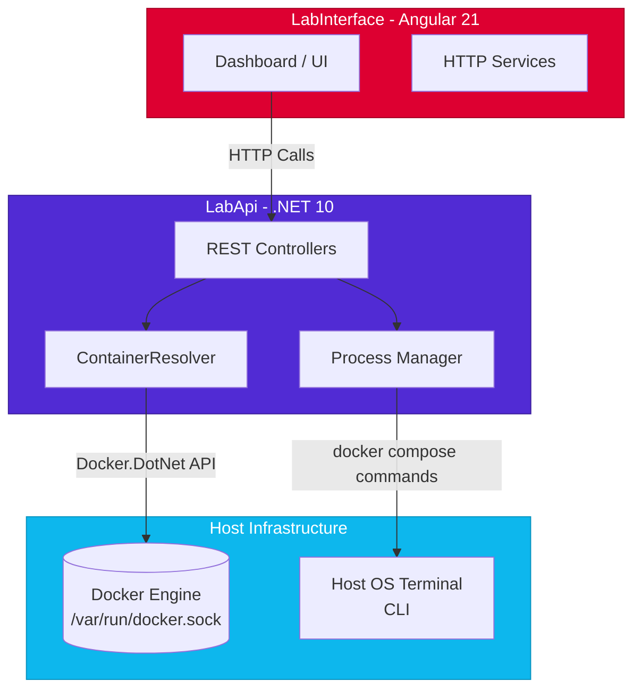
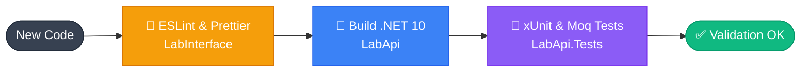

# LabMonitor

> **Project Status:** This project is currently under active development. It is a **prototype** (Proof of Concept) aimed at building a robust architecture for container administration. Features are subject to change.

**LabMonitor** is a custom web dashboard (in the style of a "mini-Portainer") designed to monitor, manage, and control Docker containers and Docker Compose stacks. It provides a modern and smooth graphical user interface to replace the complexity of CLI commands, while ensuring reliable and stateless backend execution.

---

## Key Features

*   **Project Overview:** Smart grouping of containers by stack (e.g., `sae4`).
*   **Real-time Telemetry:** Live display of CPU usage, RAM consumption, and active/inactive container counts.
*   **Health Statuses:** Visual indicators (Healthy, Warning, Error) based on sub-container states (`running`, `restarting`, `exited`, `dead`).
*   **Advanced Filtering:** Powerful search engine enabling container filtering by `id`, `name`, or `image` using strict operators (`eq`, `contains`, `startswith`, `endswith`).
*   **Stack Management:** Dynamically stop and start `docker compose` environments directly from the interface.

---

## Tech Stack

The project is split into two distinct applications, promoting decoupling and testability.

### Backend (`LabApi`)
*   **Framework:** .NET 10.0 (C#)
*   **Docker Engine:** `Docker.DotNet` (via the `/var/run/docker.sock` socket)
*   **System Execution:** Native `Process.Start` API for running `docker compose` commands (replaces FluentDocker for better stateless stability).
*   **Testing:** `xUnit` and `Moq` (Interface-driven architecture and Dependency Injection).

### Frontend (`LabInterface`)
*   **Framework:** Angular 21 (with Server-Side Rendering - SSR)
*   **Styling:** Tailwind CSS v4 (Dark theme tailored for a technical dashboard)
*   **Standards:** Modern Control Flow (`@if`, `@for`), modern dependency injection (`inject()`), and strict compliance with **ESLint** & **Prettier** rules.

---

## System Architecture

The diagram below illustrates how the frontend communicates with the API, which in turn interacts with the host Linux system and the Docker daemon.

## Continuous Integration (CI) & Testing

Code quality is ensured by a two-step verification pipeline: syntax validation (Linter) on the Frontend, followed by running mocked unit tests on the Backend.

## Focus on Test Engineering
API tests are isolated from the physical Docker engine using Moq. The system injects mock Docker clients (`IDockerClient`, `IContainerOperations`) to guarantee test execution within milliseconds, regardless of the host environment, and to validate LINQ filtering logic independently of the underlying infrastructure.
